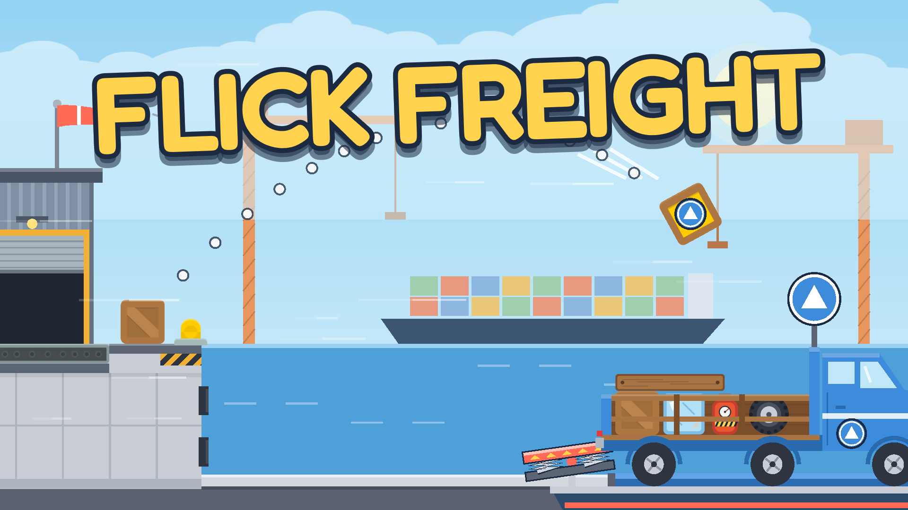

# Flick Freight

A physics loading game for the web (Godot 4.3). Drag back and release to throw cargo
from the loading dock into the truck. 25 levels across 4 worlds, 1–3 stars each.



## How it plays

- **Controls:** press anywhere, drag back, release. The dotted arc previews the throw.
  `P` pauses, `R` restarts. Touch works the same way.
- **Goal:** load enough cargo to pass (1★); load more for 2★; load everything for 3★.
- **Trucks** leave when full and a new one drives in.
- **Mechanics** (introduced one at a time): moving trucks, heavy crates (need more power),
  barrels (tip over), fragile cargo (breaks on walls/road), pillars and low beams, wind, tall tailgates.
- **Harbor (world 4):** bounce pads (bank shots; a pad never breaks fragile cargo), colour-coded
  trucks (colour + shape; cargo in the wrong truck is a miss and stays as dead weight), and trucks
  bobbing on ferries. Each world is a page in level select; a world opens once the previous one is done.
- Progress (stars, mute, tutorial) is saved locally. New players land straight in level 1.

## Project layout

```
scripts/
  main.gd        boot + level flow + pause
  game.gd        one level: scene build, cargo queue, aiming, scoring
  truck.gd       side-view truck (code-drawn), motion, carried cargo
  cargo.gd       cargo physics + resolve (delivered / missed / broken)
  levels.gd      ALL level data (add a level = add a dictionary; keys documented at the top)
  backdrops.gd   code-drawn backgrounds for Harbor and later worlds
  hud.gd         top bar, banners, pop-ups, tutorial
  screens.gd     pause, results (stars), level select
  ui_theme.gd    shared theme (Fredoka font, buttons, cards)
  save_data.gd   user:// persistence
  sfx.gd, fx.gd  audio + particles
tools/
  bot.gd         QA bot: plays levels (analytic solver for 1-15, search solver after)
  bot_sim.gd     throw model for the search solver
  frozen_check.gd  hash check that levels 1-15 never change
  baseline_v2_*.json  regression baselines for levels 1-15
  cover.gd       renders the CrazyGames cover images
  make_music.py  synthesizes the music loop
  make_sfx.py    synthesizes boing / splash / pop
art/v2/          Kenney CC0 art + Fredoka (OFL) — see art/v2/CREDITS.md
marketing/covers 1920x1080, 800x1200, 800x800 covers for portal submission
```

## Build & test

```bash
godot --headless --import
godot --headless --export-release "Web" export/index.html     # single-threaded web build

# play every level with perfect aim (exit 1 if any level can't be passed)
godot --headless --fixed-fps 60 -s res://tools/bot.gd -- --levels=all --error=0
# simulate a human (aim error)
godot --headless --fixed-fps 60 -s res://tools/bot.gd -- --levels=all --error=0.5
```

### Guardrails (run by CI on every branch, see `docs/EXPANSION_PLAN.md`)

Levels 1–15 and the mechanics they use are frozen. Three checks enforce it:

```bash
# levels 1-15 data unchanged (hash in tools/frozen_levels.sha256)
godot --headless -s res://tools/frozen_check.gd
# regression gate: levels 1-15 must give exactly the baseline results
# (always run the full 1-15 range: physics stacking makes single levels differ)
godot --headless --fixed-fps 60 -s res://tools/bot.gd -- --levels=1-15 --error=0   --compare=res://tools/baseline_v2_e0.json
godot --headless --fixed-fps 60 -s res://tools/bot.gd -- --levels=1-15 --error=0.5 --compare=res://tools/baseline_v2_e05.json
```

The bot uses the original analytic solver for levels 1–15 and a search solver
(`tools/bot_sim.gd`, `--solver=sim`) for later levels. The search solver steps every
candidate throw through a model of the level and reports how many candidates land.
`--json=res://out.json` writes per-level results (regenerate a baseline only on purpose).

# covers (needs a display, e.g. xvfb-run)
godot --rendering-driver opengl3 -s res://tools/cover.gd -- --out=marketing/covers
```

Screenshots (needs a display): `xvfb-run -a godot --rendering-driver opengl3 -s res://tools/bot.gd -- --levels=16 --snap=shot.png --snap_at=5`

`?level=N` in the URL (or `-- --level=N` on the command line) jumps to a level for testing.
