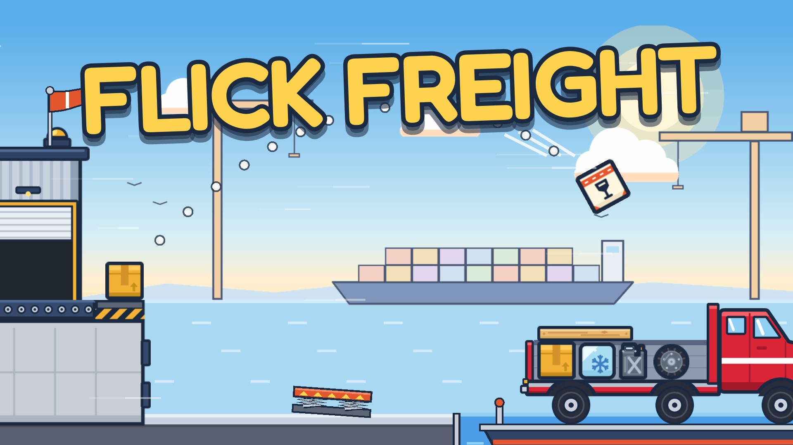

# Flick Freight

A physics loading game for the web (Godot 4.3). Drag back and release to throw cargo
from the loading dock into the truck. 96 levels across 9 worlds, 1–3 stars each.
Full design write-up: [Game Design Document (PDF)](docs/Flick_Freight_GDD.pdf).



## How it plays

- **Controls:** press anywhere, drag back, release. The dotted arc previews the throw.
  `P` pauses, `R` restarts. Touch works the same way.
- **Goal:** load enough cargo to pass (1★); load more for 2★; load everything for 3★.
- **One of each:** on levels with several cargo types, the level only passes with at least one of every type
  loaded (the total needed is unchanged). The top bar shows a chip per type (it no longer lists the waiting cargo: that is the pile behind Freddy). Few-throws levels and the
  one-of-everything level are exempt.
- **One truck per level:** stack it full (a few later levels have several vehicles at once,
  like a train of flatcars or two helicopters).
- **Loose cargo:** delivered cargo isn't glued down. Stacks can shift or topple, and anything that
  falls out of the truck stops counting. Stacks get a moment to settle before a level is scored.
- **Mechanics** (introduced one at a time): moving trucks, heavy crates (need more power),
  barrels (tip over), fragile cargo (each bump cracks it, the 3rd breaks it), pillars and low beams, wind, tall tailgates.
- **Harbor (world 4):** bounce pads (bank shots, also with downward throws; a pad never cracks
  fragile cargo) and trucks bobbing on ferries. Each world is a page in level select; a world opens once the previous one is done.
- **Snow (world 5):** ice blocks and icy truck beds (everything slides), bouncy tires, planks that spin
  at a fixed rate and only count if they land flat.
- **Freight Yard (world 6):** gas canisters: land them softly, or they pop in a puff of smoke and knock
  nearby cargo out of the truck (knocked-out cargo stops counting until it lands again; fragile
  neighbours break). Level 40 has one of everything.
- **Act II (Plan 2, `docs/EXPANSION_PLAN_2.md`):** each world gets 5 more levels after its Act I,
  unlocked once Act I is done. The next world opens once every level of this one (Act I and
  Act II) has been won at least once. Town: a courier motorcycle (3 boxes on a tiny rack: 1 is easy, 3 is
  very hard) and a garbage truck with a small hopper. Harbor: a swinging gantry-crane container and
  a forklift patrolling the quay. Moving obstacles run on the level clock, so they're identical
  on every restart; warning lights and sounds tell you what's coming.
- Each new world has its own music loop (`tools/make_music.py <out.ogg> harbor|snow|yard`).
- **Main menu:** the game opens on a title screen drawn over the next unbeaten level (its truck
  drives in and parks). PLAY starts that level; LEVELS opens level select; there is a mute toggle
  and the total star count. Pause and results screens have a home button back to the menu.
  `?level=N` (dev builds / localhost / GitHub Pages) still skips the menu.
- **Freddy the dock worker** (`scripts/worker.gd`, code-drawn, decoration only) stands on a low step cut into
  the dock under the loading spot. The level's cargo is tossed out of the warehouse and piled up behind him; the
  next piece hops from the pile into his hands, right above his head. He squats and sways with it while you pull
  back (stressed), swings through on the throw, and is happy when it lands in the truck, sad when it misses.
  The cargo's launch point, timing and the dock's collision box are unchanged.
- Progress (stars, mute, tutorial) is saved locally.
- **CrazyGames SDK v3:** `custom_html/custom_shell.html` loads it and reports loading start/stop;
  `scripts/portal.gd` reports gameplay start/stop (level start, pause, resume, level end) and
  `happytime` when a world's last level is beaten. Off CrazyGames every call is a no-op;
  add `?useLocalSdk=true` to the URL to test the calls (logged by the SDK) on GitHub Pages.

## Art

The game uses the "Morning Hybrid" look: flat side view, chunky shapes with navy outlines drawn
inside the shape, bright morning light. PNG art is in `art/v3/` and is picked up by
`scripts/art/assets.gd`; vehicles, moving obstacles and static obstacles are drawn in code with
`scripts/art/draw_kit.gd` and the colours in `scripts/art/palette.gd`. `docs/ART_SWAP_MAP.md`
lists every item and where it lives. Art changes are visual only: collision shapes and level
data never change.

## Project layout

```
scripts/
  main.gd        boot + main menu + level flow + pause
  game.gd        one level: scene build, cargo queue, aiming, scoring
  truck.gd       side-view truck (code-drawn), motion, carried cargo
  cargo.gd       cargo physics + resolve (delivered / missed / broken)
  levels.gd      ALL level data (add a level = add a dictionary; keys documented at the top)
  backdrops.gd   code-drawn backgrounds for Harbor and later worlds
  cargo_vehicle.gd  the interface every vehicle implements (the truck is V0)
  vehicle_base.gd  shared code for the new vehicles; vehicle_moto.gd, vehicle_garbage.gd
  movers/        crane, forklift, ...; garage_door and bus (also a train) are no longer used by any level
                 (they made players wait)
  vehicles.gd    vehicle factory ("vehicle" key in a truck config)
  mover.gd, movers.gd  moving obstacles: pose = f(level clock), AnimatableBody2D
  bridges.gd     the low bridges (height limit; no level in play uses it any more)
  hud.gd         top bar, banners, pop-ups, tutorial
  screens.gd     pause, results (stars), level select
  ui_theme.gd    shared theme (Fredoka font, buttons, cards)
  save_data.gd   user:// persistence
  sfx.gd, fx.gd  audio + particles
tools/
  bot.gd         QA bot: plays levels (analytic solver for 1-15, search solver after)
  bot_sim.gd     throw model for the search solver (vehicles, movers, release timing)
  parity.sh      levels 6-40, one process each, must match the pre-Plan-2 snapshot
  replay_check.sh  new levels must replay identically 3 times
  timing_test.sh release-time search test with a dev gate (tools/test/)
  save_test.gd, layout_check.gd, cab_test.gd  other CI checks
  frozen_check.gd  hash check that levels 6-40 never change
  baseline_1_40*.json  regression snapshot of levels 1-40 (results + throws; 1-5 no longer compared)
  cover.gd       renders the CrazyGames cover images
  make_music.py  synthesizes the music loop
  make_sfx.py    synthesizes boing / splash / pop
  make_cargo_art.py  draws the ice / tire / plank / canister sprites
  make_gdd.py    builds docs/Flick_Freight_GDD.pdf from scripts/levels.gd (rerun after level changes)
art/v2/          Kenney CC0 art + Fredoka (OFL) — see art/v2/CREDITS.md
marketing/covers 1920x1080, 800x1200, 800x800 covers for portal submission (Harbor scene)
docs/EXPANSION_PLAN.md  the plan behind worlds 4-6 and the guardrails
docs/Flick_Freight_GDD.pdf  game design document: goal, rules, worlds, full level list
```

## Build & test

```bash
godot --headless --import
godot --headless --export-release "Web" export/index.html     # single-threaded web build

# play every level with perfect aim (exit 1 if any level can't be passed)
godot --headless --fixed-fps 60 -s res://tools/bot.gd -- --levels=all --error=0
# simulate a human (aim error)
godot --headless --fixed-fps 60 -s res://tools/bot.gd -- --levels=all --error=0.5
```

### Guardrails (run by CI on every branch)

Levels 6–40 are frozen (`docs/EXPANSION_PLAN_2.md` §1). Levels 1–5 were unfrozen on purpose
to make the opening livelier (shorter levels, the moving truck at level 2). The checks:

```bash
godot --headless -s res://tools/frozen_check.gd       # levels 6-40 data unchanged
godot --headless -s res://tools/layout_check.gd       # no vehicle drives through an obstacle
godot --headless --fixed-fps 60 -s res://tools/cab_test.gd
godot --headless -s res://tools/save_test.gd          # old saves keep their levels; world unlock rule
# parity: each of levels 6-40 in its own process must give the same results AND the same
# throws as the snapshot taken before Plan 2 (one process per level: no level can affect another)
tools/parity.sh check
```

The bot uses the original analytic solver for levels 1–15 and a search solver
(`tools/bot_sim.gd`, `--solver=sim`) for later levels. The search solver steps every
candidate throw through a model of the level and reports how many candidates land.
`--json=res://out.json` writes per-level results (regenerate a baseline only on purpose).

# covers (needs a display, e.g. xvfb-run)
godot --rendering-driver opengl3 -s res://tools/cover.gd -- --out=marketing/covers
```

Screenshots (needs a display): `xvfb-run -a godot --rendering-driver opengl3 -s res://tools/bot.gd -- --levels=16 --snap=shot.png --snap_at=5`

Levels have permanent IDs (their index in `Levels.DATA`, the save key); the number players
see follows play order (`Levels.order()`: each world's Act I, then its Act II). Moving
obstacles read the level clock `Game.frame`; in debug builds `[` / `]` scrub it by half a second.

`?level=N` in the URL (the number players see) (or `-- --level=N` on the command line) jumps to a level for testing.
